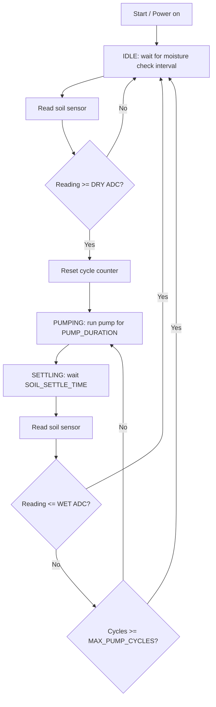
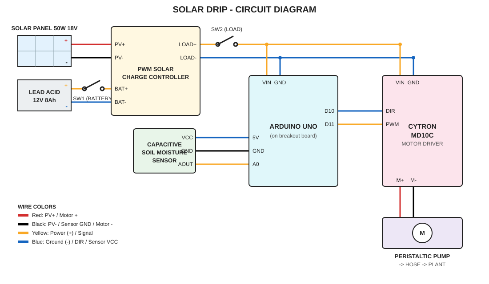

# SOLAR DRIP

## OVERVIEW

SOLAR DRIP is a solar-powered automatic drip irrigation controller. A 50W solar panel charges a 12V 8Ah lead acid battery through a PWM charge controller. The charge controller's load output powers an Arduino Uno and a Cytron MD10C motor driver. The Arduino reads a capacitive soil moisture sensor and, when the soil is dry, drives a peristaltic pump through the motor driver to water the plant through a hose.

Key features:

- Fully solar powered and off-grid.
- Non-blocking firmware (`millis()` state machine, no `delay()`).
- Re-checks the soil after pumping and pumps again until the soil is wet.
- Hysteresis between the dry and wet thresholds to prevent rapid on/off cycling.
- Safety limit on pump cycles per watering session.
- All tunables are macros at the top of [src/main.cpp](src/main.cpp).

## MATERIALS

| Item | Image | General Description | Usage | Unit Price | Quantity | Amount |
| --- | --- | --- | --- | --- | --- | --- |
| CYTRON MD10C |  | 10A DC motor driver with DIR and PWM inputs | Drives the peristaltic pump with controllable speed and direction | ₱ 774.00 | 1 | ₱ 774.00 |
| ARDUINO UNO |  | ATmega328P microcontroller board | Main controller; reads the soil sensor and runs the watering logic | ₱ 250.00 | 1 | ₱ 250.00 |
| ARDUINO UNO BREAKOUT BOARD |  | Screw-terminal shield for the Arduino Uno | Secure wire connections for power, sensor and motor driver | ₱ 200.00 | 1 | ₱ 200.00 |
| LEAD ACID BATTERY 12V 8AH |  | Sealed rechargeable 12V 8Ah battery | Stores solar energy so the system runs at night and on cloudy days | ₱ 600.00 | 1 | ₱ 600.00 |
| PWM SOLAR CHARGE CONTROLLER |  | PWM charge controller with PV, battery and load terminals | Regulates battery charging and provides the switched 12V load output | ₱ 300.00 | 1 | ₱ 300.00 |
| CAPACITIVE SOIL MOISTURE SENSOR |  | Analog corrosion-resistant soil moisture sensor | Measures soil moisture (raw ADC value; higher means drier) | ₱ 60.00 | 1 | ₱ 60.00 |
| SWITCH |  | Toggle switch | Manual power on/off for the battery and load lines | ₱ 100.00 | 1 | ₱ 100.00 |
| PERISTALTIC PUMP |  | 12V DC peristaltic (tube) pump | Moves water from the reservoir to the plant | ₱ 500.00 | 1 | ₱ 500.00 |
| HOSE |  | Flexible water tubing | Carries water from the reservoir through the pump to the plant | ₱ 200.00 | 1 | ₱ 200.00 |
| SOLAR PANEL 50W 18V |  | 50W, 18V photovoltaic panel | Generates power to charge the battery | ₱ 1,168.00 | 1 | ₱ 1,168.00 |
| SINTRA BOARD A4 |  | A4-size rigid PVC foam board | Casing for the electronics | ₱ 200.00 | 2 | ₱ 400.00 |
| CYANOACRYLATE SUPER GLUE |  | Fast-curing instant adhesive | Bonds the Sintra board panels into the casing | ₱ 150.00 | 1 | ₱ 150.00 |
| **TOTAL** | | | | | | **₱ 4,702.00** |

> Place the product photos (400x400 px) in an `images/` folder using the file names above.

## STEP-BY-STEP MAKING PROCESS

1. **Casing assembly:** cut and assemble the Sintra board casing, bonding the panels with cyanoacrylate super glue.
2. **Holes and mounting:** bore the holes for the switch and the MC4 panel mount connectors. Drill the mounting screw holes for the motor driver and the Arduino Uno.
3. **Battery to charge controller:** wire the battery to the solar charge controller, then set the controller to **B1** (lead acid battery type).
4. **Solar input:** wire the MC4 connectors to the charge controller PV input.
5. **Load side:** wire the charge controller load output through the switch to the Arduino `VIN` and the motor driver power supply.
6. **Pump:** connect the peristaltic pump to the motor driver motor output.
7. **Soil sensor:** wire the analog capacitive soil moisture sensor to the Arduino (`5V`, `GND`, `A0`).
8. **Code and testing:** develop the code, upload it, and test it thoroughly. Calibrate the dry and wet ADC values before final use.

## ALGORITHM

1. On boot the pump is off and the first moisture check runs immediately.
2. In `IDLE`, the soil is checked every `MOISTURE_CHECK_INTERVAL`.
3. If the reading is at or above `SOIL_DRY_ADC_RAW`, the soil is dry and a watering session starts.
4. In `PUMP_RUNNING`, the pump runs at `PUMP_SPEED_PERCENT` for `PUMP_DURATION`.
5. In `PUMP_SETTLING`, the pump is off for `SOIL_SETTLE_TIME` so water can soak in.
6. The soil is read again:
   - At or below `SOIL_WET_ADC_RAW`: the soil is wet, the session ends and the system returns to `IDLE`.
   - Still above the wet value and fewer than `MAX_PUMP_CYCLES` pump runs: pump again (step 4).
   - `MAX_PUMP_CYCLES` reached: stop and wait for the next scheduled check (protects against an empty tank or faulty sensor).
7. Readings between the wet and dry values do not start watering (hysteresis).

## CODE EXPLANATION

The firmware is in [src/main.cpp](src/main.cpp) (PlatformIO, Arduino framework, Arduino Uno).

### User settings (macros)

| Macro | Default | Description |
| --- | --- | --- |
| `PUMP_SPEED_PERCENT` | `60` | Pump speed, 0-100 % |
| `PUMP_DURATION` | `SECONDS(3)` | How long the pump runs per cycle |
| `MOISTURE_CHECK_INTERVAL` | `MINUTES(30)` | Time between moisture checks |
| `PUMP_DIRECTION` | `HIGH` | Set to `LOW` if the pump runs backwards |
| `SOIL_DRY_ADC_RAW` | `550` | Raw ADC at or above which soil is dry |
| `SOIL_WET_ADC_RAW` | `450` | Raw ADC at or below which soil is wet |
| `SOIL_SETTLE_TIME` | `SECONDS(30)` | Wait after pumping before re-checking |
| `MAX_PUMP_CYCLES` | `5` | Maximum pump runs per watering session |
| `DEBUG_SERIAL` | `1` | `1` prints readings over Serial at 9600 baud |

Time macros `SECONDS(n)` and `MINUTES(n)` convert to milliseconds and can be combined, e.g. `MINUTES(1) + SECONDS(30)`.

Calibration: read the sensor in air (dry) and in water (wet) from the Serial monitor, then pick `SOIL_WET_ADC_RAW` and `SOIL_DRY_ADC_RAW` between those readings. The wet value must be lower than the dry value, otherwise the build fails.

### Pins

| Pin | Connected to |
| --- | --- |
| D10 | Cytron MD10C `DIR` |
| D11 | Cytron MD10C `PWM` |
| A0 | Soil sensor `AOUT` |

### Functions

- `readSoilMoisture()` averages 8 `analogRead()` samples to reduce noise.
- `pumpStart()` sets the direction pin, applies PWM, records the start time, increments the cycle count and enters `PUMP_RUNNING`.
- `pumpStop()` sets PWM to 0, records the time and enters `PUMP_SETTLING`.
- `setup()` configures pins, ensures the pump is off, starts Serial and schedules the first check immediately.
- `loop()` is a non-blocking state machine using `millis()`:
  - `PUMP_IDLE`: periodic moisture check; starts watering if dry.
  - `PUMP_RUNNING`: stops the pump when `PUMP_DURATION` elapses.
  - `PUMP_SETTLING`: after `SOIL_SETTLE_TIME`, re-reads the soil and either finishes, gives up, or pumps again.

## CIRCUIT DIAGRAM

### Wiring

| From | To |
| --- | --- |
| Solar panel `+` (red) | Charge controller `PV+` |
| Solar panel `-` (black) | Charge controller `PV-` |
| Battery `+` (yellow) | Switch, then charge controller `BAT+` |
| Battery `-` (blue) | Charge controller `BAT-` |
| Charge controller `LOAD+` | Switch, then Arduino `VIN` and MD10C `VIN` (yellow) |
| Charge controller `LOAD-` | Arduino `GND` and MD10C `GND` (blue) |
| MD10C `DIR` (blue) | Arduino `D10` |
| MD10C `PWM` (yellow) | Arduino `D11` |
| MD10C `M+` / `M-` | Peristaltic pump |
| Soil sensor `VCC` (blue) | Arduino `5V` |
| Soil sensor `GND` (black) | Arduino `GND` |
| Soil sensor `AOUT` (yellow) | Arduino `A0` |
